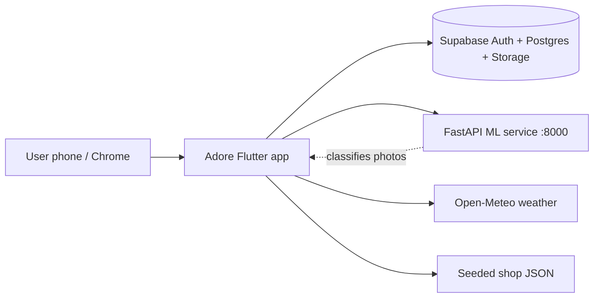
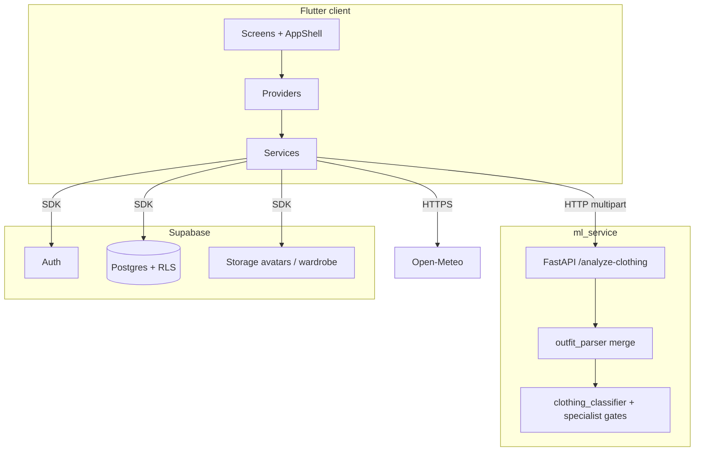
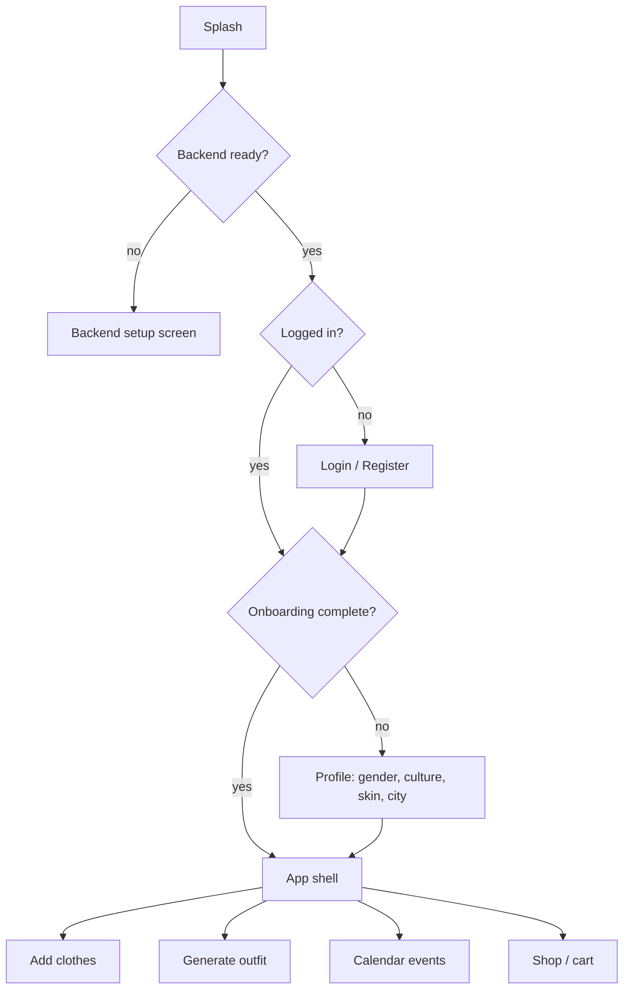
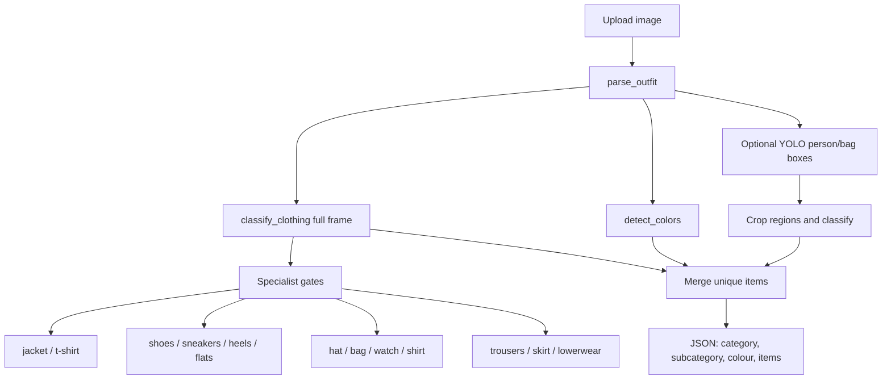
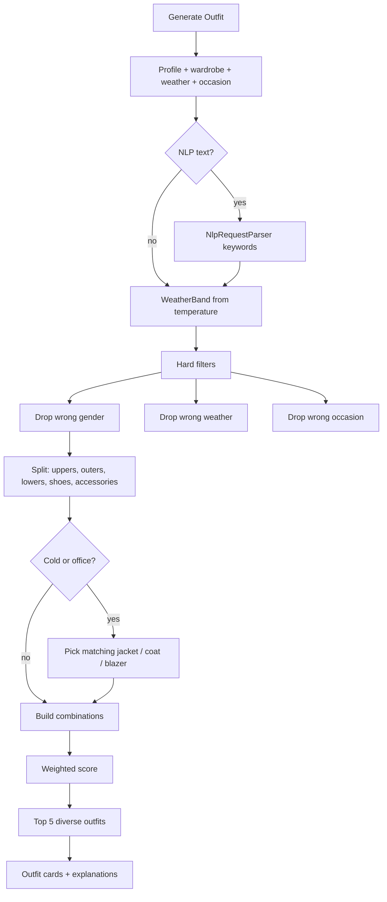
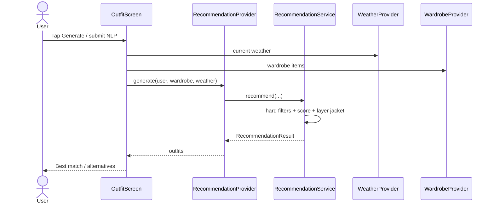
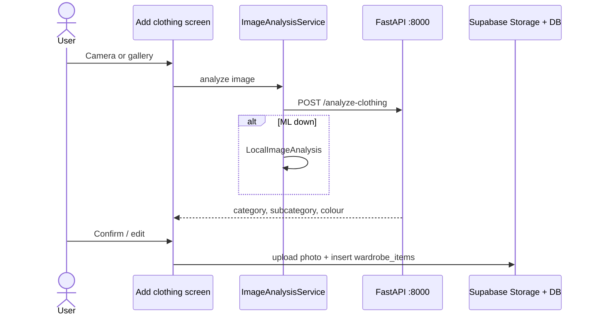
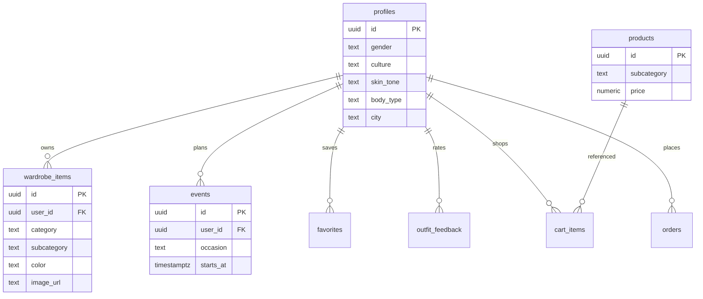
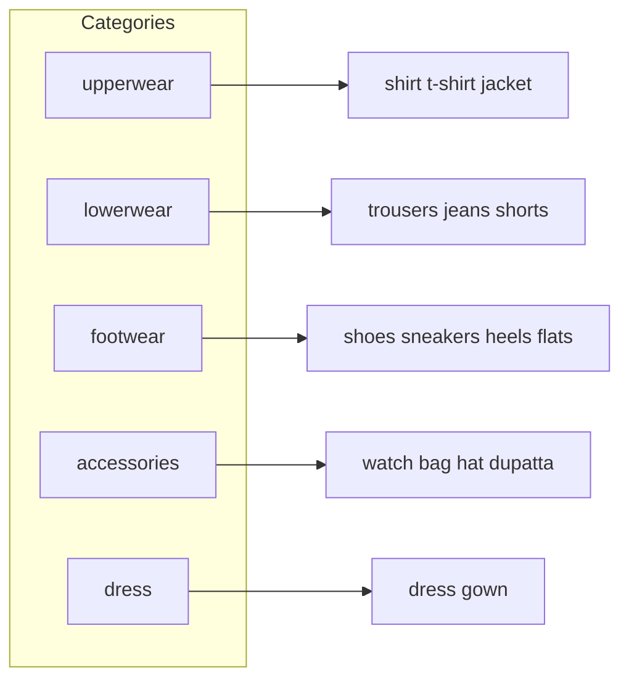
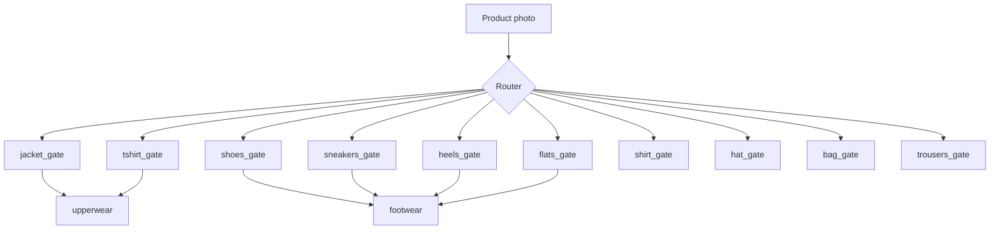

# Adore — Project Context & Documentation

**Title:** Smart Cloth Advisor and Outfit Recommender  
**Institution:** University of Azad Jammu & Kashmir, Muzaffarabad  
**Type:** Final Year Project (Group 24)  
**App:** Flutter (`adore`) · **ML:** FastAPI (`ml_service`) · **Backend:** Supabase  

This file is the **master context** for the project: problem, architecture, flows, data, and diagrams. Detailed specs live in the linked docs at the end.

Open this file from Windows with `context.cmd`.

---

## 1. Problem and goal

People often own clothes but still cannot decide **what to wear right now**. Advice from fashion sites ignores:

- what is **in the user’s wardrobe**
- **live weather**
- **culture** and modest dress
- **gender** (men’s vs women’s garments)
- **skin tone** colour harmony
- **occasion** (office, wedding, university, …)

Adore answers: *What should this user wear, from their own clothes, for this weather, culture, gender, skin tone, and occasion?*

If a slot is missing (for example no jacket on a cold day), the app can suggest a **shop** item — checkout is simulated for the FYP, not a real payment gateway.

---

## 2. System context



| External system | Role |
|---|---|
| Supabase | Email login, profile, wardrobe photos, events, cart, orders |
| FastAPI `ml_service` | Clothing labels + colours; optional skin-tone assist |
| Open-Meteo | Temperature, condition, forecast (no API key) |
| On-device analysis | Fallback if ML is down (`LocalImageAnalysis`) |

---

## 3. High-level architecture



### Flutter layers

| Layer | Path | Role |
|---|---|---|
| Screens | `lib/screens/` | Login, wardrobe, outfit, shop, calendar, profile |
| Providers | `lib/providers/` | App state (auth, wardrobe, weather, recommendations) |
| Services | `lib/services/` | API calls, recommendation engine, NLP parser |
| Models | `lib/models/` | User, wardrobe item, outfit, product |
| Catalog | `lib/utils/clothing_catalog.dart` | Labels, gender/weather/occasion rules |
| Entry | `lib/main.dart` → `lib/app.dart` | Splash → login → onboarding → `AppShell` |

### Bottom navigation

Home · Wardrobe · **Outfit** · Calendar · Shop · Profile

---

## 4. User journey



### Typical session

1. User sets **gender, culture, skin tone, location**.
2. User uploads wardrobe photos (camera or gallery).
3. ML (or on-device fallback) suggests category / subcategory / colour; user can confirm.
4. Weather loads for the profile city (or device GPS).
5. User taps **Generate Outfit** (optional NLP line: *“office look for a cold day”*).
6. Engine returns up to **5** ranked outfits with explanations.
7. Missing pieces can link to the in-app shop.

---

## 5. Clothing analysis (ML) flow



Specialists live in `ml_service/app/` (`*_gate.py`, `clothing_classifier.py`). Routing prefers a confident specialist (for example `shoes_gate`) so oxfords are not labelled as heels.

**API (local):** `http://127.0.0.1:8000`

| Method | Path | Purpose |
|---|---|---|
| GET | `/health` | Model load status |
| POST | `/analyze-clothing` | Wardrobe photo → labels |
| POST | `/analyze-skin-tone` | Face crop → ITA band |

See [API_DOCUMENTATION.md](API_DOCUMENTATION.md) and [ML_PIPELINE.md](ML_PIPELINE.md).

---

## 6. Outfit recommendation flow



### Scoring weights (`assets/data/recommendation_weights.json`)

| Factor | Weight | Meaning |
|---|---|---|
| Weather | 0.28 | Temperature / rain fit |
| Culture | 0.18 | Pakistani, Western, modest, … |
| Occasion | 0.14 | Office vs casual vs wedding |
| Colour | 0.14 | Skin tone + colour harmony |
| Preference | 0.09 | Favourite colours / styles |
| Wardrobe | 0.09 | Prefer owned items |
| Body type | 0.08 | Silhouette ranking |

**Gender (hard rule):** men’s outfits never include dresses, heels, blouses, dupattas, fashion handbags, or a generic women’s `bag`. Women’s outfits never include men’s-only items such as neckties. Shared items (shirt, trousers, sneakers, jacket) stay available to both.

**Cold weather:** every look includes a jacket, coat, or blazer chosen to match the shirt, trousers, and shoes.

Entry point: `RecommendationService.recommend()` in `lib/services/recommendation_service.dart`.

---

## 7. Sequence: generate outfit



---

## 8. Sequence: add clothing



---

## 9. Data model (Supabase)



Schema: `supabase/migrations/20260830000000_adore_schema.sql`.  
Row Level Security: users only see their own wardrobe, events, cart, and orders.

---

## 10. Clothing taxonomy (simplified)



Canonical lists: `ClothingCatalog` in `lib/utils/clothing_catalog.dart`.

---

## 11. ML specialist map (clothing)



Gates are **not** swapped casually: lowerwear and sneaker contracts are covered by regression tests.

---

## 12. Folder map

```
adore/
  lib/                    Flutter app
  assets/data/            products, trends, recommendation weights
  supabase/migrations/    Postgres schema
  ml_service/             FastAPI + Keras/PyTorch models
  test/                   Flutter unit tests
  CONTEXT.md              this file
  context.cmd             Windows opener for this file
```

---

## 13. How to run

**App**

```bat
cd /d "D:\fyp project\adore"
flutter pub get
flutter run -d chrome
```

**ML API** (optional but used for wardrobe AI)

```bat
cd /d "D:\fyp project\adore\ml_service"
.\.venv\Scripts\python.exe -m uvicorn app.main:app --host 127.0.0.1 --port 8000
```

**Demo login:** `ayesha@adore.test` / `AdoreDemo@24` (female Pakistani profile).  
For men’s outfits, set **Profile → Gender → Male**.

---

## 14. Related documentation

| Document | Contents |
|---|---|
| [README.md](README.md) | Setup, demo account, feature list |
| [PROJECT_ARCHITECTURE.md](PROJECT_ARCHITECTURE.md) | Tiers and modules |
| [ML_PIPELINE.md](ML_PIPELINE.md) | Classifiers and routing |
| [API_DOCUMENTATION.md](API_DOCUMENTATION.md) | HTTP endpoints |
| [RECOMMENDATION_ENGINE.md](RECOMMENDATION_ENGINE.md) | Scoring and filters |
| [NLP_DOCUMENTATION.md](NLP_DOCUMENTATION.md) | Keyword outfit requests |
| [DATASET_DOCUMENTATION.md](DATASET_DOCUMENTATION.md) | Training data |
| [TESTING_REPORT.md](TESTING_REPORT.md) | Test evidence |
| [LIMITATIONS.md](LIMITATIONS.md) | Known FYP limits |
| [DEPLOYMENT.md](DEPLOYMENT.md) | Ship notes |
| [DETECTION_LIMITATIONS.md](DETECTION_LIMITATIONS.md) | YOLO is not a 13-class clothing detector |

---

## 15. FYP honesty notes

- Outfit **recommendation is rule-based scoring**, not a generative AI fashion model.
- NLP is a **keyword parser**, not ChatGPT.
- Checkout **does not take real payment**.
- YOLO only helps find person/bag boxes; **garment names come from classifiers**.
